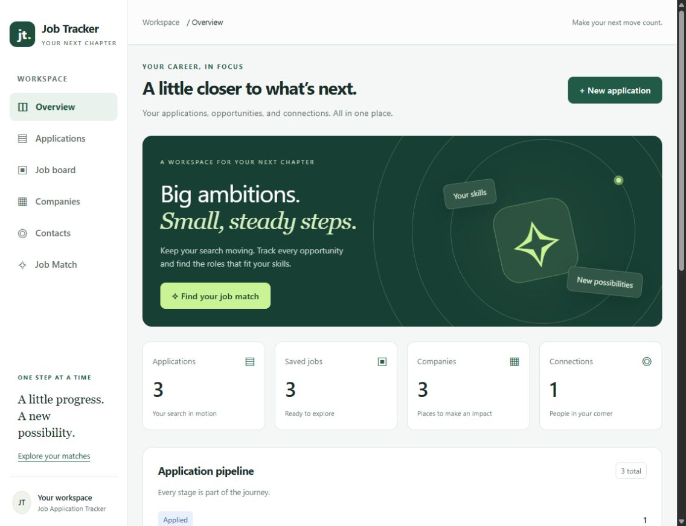

# Job Application Tracker

COP4751 course project using Python/Flask, MySQL 8, Jinja HTML, CSS, and a small amount of browser JavaScript.

## Redesigned workspace

- Sidebar navigation and responsive mobile navigation
- Dashboard with live database counts, application pipeline, and recent applications
- Decorative scroll parallax in the dashboard header; respects `prefers-reduced-motion`
- Searchable tables, an application status filter, and dedicated read-only details for all four tables
- Consistently labeled create/edit forms, validation messages, and delete confirmations
- Job Match cards with percentages, matched skills, and missing skills
- No external fonts, CDN scripts, API keys, or image services required



Preview images use fictional test data. Your dashboard reflects your own MySQL records.

## Fresh-clone setup

Install Python 3.10+ and MySQL Server 8.0.16+ first. Start the MySQL service.

Clone your repository, then enter the folder containing `app.py`, `schema.sql`, and `requirements.txt`.

### Windows PowerShell

```powershell
py -3 -m venv .venv
.\.venv\Scripts\python.exe -m pip install -r requirements.txt
```

Import `schema.sql` using MySQL Workbench: open the SQL script and execute it against your local server. Or open the MySQL command-line client and run:

```sql
SOURCE C:/absolute/path/to/job_tracker/schema.sql;
```

**The supplied schema.sql drops and recreates all four tables in `job_tracker`. Running it deletes existing application data.** Back up any data you want to keep before import, and use a disposable development database. It then creates the four tables, two companies, and two jobs; applications and contacts start empty. This is a reset script, not a migration. The earlier schema has different relationships; do not skip the schema update when setting up this version.

Set environment variables in the same PowerShell terminal used to run Flask:

```powershell
$env:DB_HOST = "localhost"
$env:DB_USER = "root"
$env:DB_PASSWORD = "your_local_mysql_password"
$env:DB_NAME = "job_tracker"
$env:SECRET_KEY = "replace-with-a-long-random-value"
.\.venv\Scripts\python.exe app.py
```

Generate a secret locally with `.\.venv\Scripts\python.exe -c "import secrets; print(secrets.token_hex(32))"` and use the result for `SECRET_KEY`. A temporary random secret is generated if omitted; flash sessions reset on server restart. Do not commit real credentials. `.env` files are not automatically loaded.

Open [http://127.0.0.1:5000](http://127.0.0.1:5000). Stop the server with Ctrl+C. Development debug mode is off by default; set `FLASK_DEBUG=1` locally if needed.

### macOS / Linux

```bash
python3 -m venv .venv
.venv/bin/python -m pip install -r requirements.txt
mysql -u root -p < schema.sql
export DB_HOST=localhost
export DB_USER=root
export DB_PASSWORD='your_local_mysql_password'
export DB_NAME=job_tracker
export SECRET_KEY='replace-with-a-long-random-value'
.venv/bin/python app.py
```

The import drops and recreates the four tables as described above. Do not run it against data you need to preserve.

## Database and CRUD

| Table | Relationship / flexible data |
| --- | --- |
| `companies` | Company name, industry, website, location, notes |
| `jobs` | FK to companies; `requirements` is native MySQL JSON |
| `applications` | FK to jobs; `interview_data` is native MySQL JSON |
| `contacts` | FK to companies; contact details and notes |

Each table supports create, list, read-only details, edit, and delete. Click **View details** in any list to inspect all fields, formatted JSON, and related records. Company details link to its jobs and contacts; job details link to its applications.

Company names are unique. A contact requires an existing company; an application requires an existing job. Deleting a company **deletes its contacts** and keeps its jobs with a NULL company reference. Deleting a job **deletes its applications**. Confirmation messages describe these cascades. The schema also checks salary ordering and requires job requirements to be a JSON object.

Server validation covers required fields, column length limits, existing foreign-key choices, enum choices, email and HTTP(S) URLs, calendar dates, salary ranges, and valid JSON. Requirements must be a JSON object; skill arrays must contain nonblank strings. User values are passed as SQL parameters. Jinja escapes displayed record content.

## Job Match

Save job requirements like this:

```json
{
  "required_skills": ["Python", "SQL", "Flask"],
  "preferred_skills": ["Docker", "AWS"],
  "remote_option": true
}
```

Enter comma-separated skills on Job Match. `Python, SQL` matches 2 of these 3 required skills: **67%** after rounding. `Python, SQL, Flask` gives **100%**.

Comparison ignores case, leading/trailing whitespace, and duplicate required skills. Preferred skills do not affect the score. There is no synonym or AI matching: `JS` and `JavaScript` differ. Jobs with NULL requirements are excluded; a job with an empty requirements object receives 0%. Results sort by percentage descending, then title.

## Tests

```powershell
.\.venv\Scripts\python.exe -m unittest discover -v
```

Use `.venv/bin/python -m unittest discover -v` on macOS/Linux. Tests use an isolated SQLite test double and do not require database credentials. The running application always uses MySQL. See [TESTING.md](TESTING.md) for verified checks and outstanding MySQL checks.

## Project structure

- `app.py`: routes, validation, match calculation
- `database.py`: parameterized MySQL access and transaction helpers
- `schema.sql`: native MySQL tables, relationships, JSON columns, starter records
- `templates/`: pages and reusable field/UI macros
- `static/style.css`, `static/app.js`: design, filters, parallax, confirmations
- `tests/`: automated integration tests and isolated database test double
- `docs/`: screenshots from the redesign preview
- `AI_USAGE.md`: AI documentation still required before submission; intentionally withheld from this repository at the owner's request
- `SUBMISSION_CHECKLIST.md`, `VIDEO_GUIDE.md`, `TESTING.md`: grading and verification guidance

## Submission

Push the contents of this folder to your GitHub repository. Include all required files and **the actual 3-7 minute recorded video file**; a script or video link alone does not meet the stated requirement. Follow [VIDEO_GUIDE.md](VIDEO_GUIDE.md), verify the video is present and playable on GitHub, and submit your repository URL.

This version was reviewed against the supplied Project Specification and uses the owner-supplied replacement schema.sql. Live MySQL verification and the recorded video are still required. Complete and add AI_USAGE.md before submission. No grade is guaranteed.
